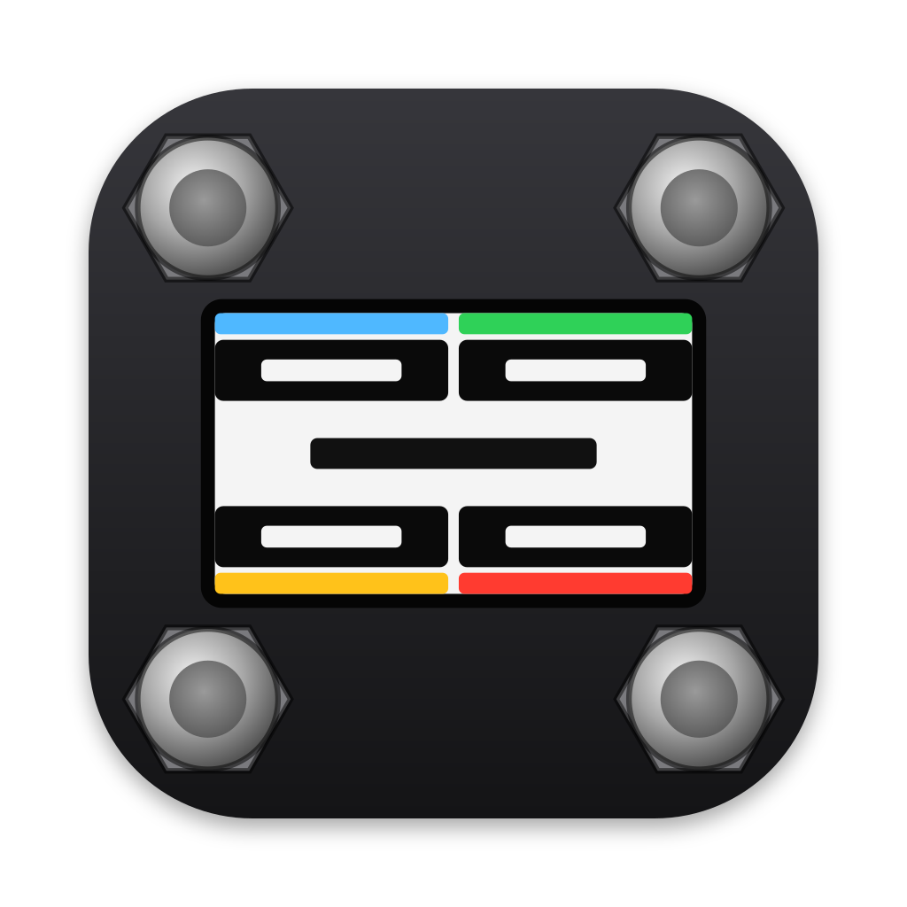
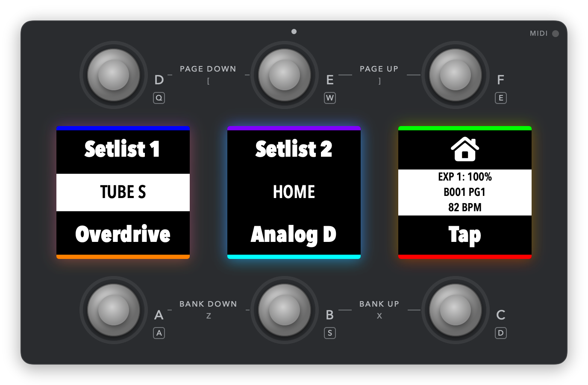

#  MC6 Virtual



MC6 Virtual is a macOS app that plays a Morningstar MC6 Pro footswitch on screen. It reads an MC6 Pro "All Banks" backup, the `.json` file that the Morningstar editor exports. It runs the button logic of that backup and sends the MIDI through two virtual MIDI ports, "MC6 Virtual 1" and "MC6 Virtual 2".

Use it to rehearse or to build a set without the hardware. Any app that reads MIDI input can use the ports. Examples are a DAW such as Ableton Live, Logic Pro or Reaper, a plugin host and a MIDI monitor.

The app is not a firmware-exact copy of the MC6 Pro. It follows the published manual and the editor's file format. Where the firmware behavior is not documented, it uses a fixed, documented rule. The backup is the only source of musical data: the app holds no bank names, presets, channels or MIDI values of its own.

## Requirements

- macOS 14 or later.
- To build: Swift 6 with the Command Line Tools. Xcode is not needed.

## Install

Download `MC6-Virtual-<version>.zip` from the [Releases](https://github.com/ivnvxd/mc6-virtual/releases) page, unzip it and move `MC6 Virtual.app` to `/Applications`. The app runs on Apple silicon and Intel Macs.

You can also install it with Homebrew:

```sh
brew install --cask ivnvxd/tap/mc6-virtual
```

To build the app from source, you need the tools in Requirements. Clone the repository and run the build script:

```sh
git clone https://github.com/ivnvxd/mc6-virtual.git
cd mc6-virtual
scripts/make-app.sh
```

The script writes `dist/MC6 Virtual.app`. Move it to `/Applications`. macOS does not block an app that your own Mac built, so you do not need the Open Anyway steps below. `swift build` alone makes only the debug program `.build/debug/MC6App`, without the app bundle and its icon.

The app is not notarized by Apple, so macOS blocks the first launch. To allow it:

1. Double-click the app. macOS shows that it cannot check the app. Click Done.
2. Open System Settings > Privacy & Security, scroll down and click Open Anyway.
3. Open the app again and click Open Anyway.

As an alternative, remove the quarantine attribute in Terminal before the first launch:

```sh
xattr -dr com.apple.quarantine "/Applications/MC6 Virtual.app"
```

The app needs no network.

To update, run `brew upgrade --cask mc6-virtual`, or download the new zip and replace the app. Each new version asks for Open Anyway again.

Run one copy at a time. A second copy cannot create the ports, because the first copy holds their IDs. It shows "MIDI ports unavailable" and keeps Arm off. Closing the main window quits the app and frees the ports.

## Using the app

### Open a backup

Choose File > Open (⌘O) and pick the backup file, or drop the file on the window. You can also use Open With > MC6 Virtual in Finder, or drop the file on the app's Dock icon. The window title shows the file name. The app never changes the file.

The app remembers the last 5 backups in File > Open Recent and opens the newest one again at launch. You can turn this off in Settings. File > Reload Backup (⇧⌘R) reads the open file again. Each export from the Morningstar editor gets a new file name, so open the new export after you change the backup.

A file that is not an MC6 Pro All Banks backup, or that is broken, does not load. The window says why, and Copy puts the problems on the clipboard. The backup that was loaded before stays loaded. If the app skips some content of a backup, a line under the toolbar says so. See "Supported backups" below.

### Dry Run and Live

The app starts in Dry Run. In Dry Run, the MIDI goes only to the log. If you turn on "Start Live at launch" in Settings, the app arms after the launch opens the last backup.

- Click Arm (⌘L) to go Live. In Live, the MIDI goes to the ports and to the log.
- Arm works like switching on the MC6. The app goes back to the first bank, page 1, with every preset at Position 1. Then it sends the On Enter Bank messages of the first bank, so the receiving app gets the start state of your setup.
- Click Disarm to go back to Dry Run.
- Open, Reload, Reset and Disarm stop all pending messages and go back to Dry Run.
- An error, for example a send error or too many messages in one press, stops the app in the Error state. The banner names the preset and the message. Click Arm to go on, or Back to Dry Run.
- In Dry Run, the Sent list says that nothing went to the MIDI ports, and it has an Arm button.

Apart from that setting, the app never arms by itself. Launch and Open send no MIDI to the ports. They run the On Enter Bank messages of the first bank in Dry Run, so the screen shows the start state. If "Start Live at launch" is on, these messages run in Dry Run first. Then the app arms and runs them again, live.

### The panel

The window draws the MC6 Pro front: switches D E F on top, A B C below, and three color screens between the rows.

- Each switch has a band on its screen with the preset name, its icons and its colors from the backup. A strip on the outer edge shows the switch's LED color.
- At Position 2, the band shows the toggle name, the toggle colors and a "2" mark.
- A "!" mark in the lower corner of a band means that the app skips some content of that preset.
- While you hold a switch, its band lights up.
- Screen 1 shows the long name of the last switch you pressed in its center band. Screen 2 shows the bank name. Screen 3 shows the expression value, the bank and page, or the tap tempo.
- Click BANK DOWN, BANK UP, PAGE DOWN or PAGE UP on the panel to step banks and pages. These print lines sit where the hardware's two-switch combos are. The dots at the top show the page. Steps send no MIDI themselves, but a step into a bank with On Enter Bank messages runs them.
- The sidebar lists the banks. Click a bank to go to its page 1.
- The MIDI light in the top-right corner shows the mode: green in Live, gray in Dry Run, red in Error. It flashes on each output.
- The Sent list under the panel shows all outputs of the last press in plain words, also the ones that come after a delay. An example is "+10 ms  Port 1  ch 3  CC 20 = 127  A BOOST, message 4". The time counts from the switch down. Dry Run outputs show as "dry". The next switch down or engage clears the list. A pedal move after a press also clears it, and then each pedal move adds to it. The list shows the newest 200 outputs, and its header counts all of them.

View > Compact Mode (⌥⌘C) shows only the panel, with the banners for errors. In compact mode, the panel prints the mode next to the MIDI light. View > Zoom In (⌘=), Zoom Out (⌘-) and Actual Size (⌘0) scale the panel from 70% to 150%. The window follows. The app remembers both.

The colors are close to the hardware, not exact. Morningstar names the palette colors but does not publish their RGB values.

### Keys

| Key | Function |
|---|---|
| Q W E | switches D E F |
| A S D | switches A B C |
| Z X | bank down, bank up (the hardware's A+B and B+C) |
| [ ] | page down, page up (the hardware's D+E and E+F) |
| 1 2 3 | the presets I, J and K of the bank (the hardware's A+D, B+E and C+F) |
| ↑ ↓ | move the expression pedal, by the fine step with Option |

These are the default keys. You can change them in Settings > Keys. The keys go by physical position, so they work with any keyboard layout. The mouse works the same way on the switches. The keys work only while the main window has focus.

Bank and page keys send no MIDI themselves. A bank key runs the On Enter Bank messages of the new bank. Keys 1, 2 and 3 run their preset as a short tap. In a bank with one page, they do nothing.

### Footswitches

- Short press: Press, then Release on up.
- Hold for the long-press time: Long Press, then Long Press Release on up. A ring on the held switch fills up to the long-press time.
- Double tap: only on presets that have double-tap messages. They wait for a second tap, 300 ms by default.

The long-press time comes from the backup's `longPressTime` setting. You can set another time in Settings. When the window loses focus, held switches let go.

A Bank Jump, Bank Up or Bank Down waits for the end of the press, as on the MC6 Pro. The end of a hold is the moment that you let go of the switch.

### Expression pedal

The slider is expression input 1, from 0 to 127. The pedal sends nothing until you move it. At start, every message of the input is active, as on the MC6 Pro after power-on. A Select Expression message then chooses which messages the pedal sends. You can move the pedal in three ways:

- Drag the slider.
- Scroll over the slider with a mouse wheel or a trackpad. Up raises the value, whatever the natural scrolling setting is.
- Press ↑ or ↓. A press moves one arrow step. If you hold the key, the pedal sweeps from 0 to 127 in the hold sweep time, 1 second by default. With Option, the step is the fine step and the sweep is 4 times slower.

### Reset

Controls > Reset (⇧⌘⌫) asks first. Then the app goes back to the first bank, page 1, puts every preset at Position 1 and disarms. It runs the On Enter Bank messages of the first bank in Dry Run. Reset sends no MIDI to the ports, so the receiving app keeps its state.

### Log

Window > Log (⌥⌘L) shows each output with its time, bytes, port, the message in plain words and its source preset. It also shows the taps, errors and import notes. The app keeps the newest 10,000 lines. You can change that number in Settings.

File > Export Log (⇧⌘E) writes the log as JSON lines (`.jsonl`). Each line has `ms` (milliseconds since launch) and `kind` (`output`, `tap` or `fault`). Output lines also have `bytes`, `ports` (`[1]`, `[2]` or `[1, 2]`), `pointer` and `live`. Fault lines have `pointer` and `reason`.

### Menus

| Menu | Item | Shortcut |
|---|---|---|
| File | Open… | ⌘O |
| File | Open Recent | |
| File | Reload Backup | ⇧⌘R |
| File | Export Log… | ⇧⌘E |
| Controls | Arm or Disarm | ⌘L |
| Controls | Reset… | ⇧⌘⌫ |
| Controls | Bank Down, Bank Up, Page Down, Page Up | Z, X, [ and ] (the keys of Settings > Keys) |
| View | Compact Mode | ⌥⌘C |
| View | Zoom In, Zoom Out, Actual Size | ⌘=, ⌘- and ⌘0 |
| Window | Log | ⌥⌘L |
| MC6 Virtual | Settings… | ⌘, |

### Settings

Each change applies at once, except the port names. Settings has two tabs, General and Keys.

| Setting | Default | Range |
|---|---|---|
| Long press | from the backup | custom 300 to 1500 ms |
| Double tap window | 300 ms | 150 to 600 ms |
| Arrow step and fine step | 8 and 1 | 1 to 32 and 1 to 8 |
| Hold sweep time, 0 to 127 | 1000 ms | 300 to 3000 ms |
| Screen brightness | from the backup | custom 30 to 100% |
| Switch letters on screens | from the backup | on, off |
| Keep log entries | 10,000 | 1,000 to 100,000 |
| Port names | MC6 Virtual 1, MC6 Virtual 2 | applied at the next launch |
| Open the last backup at launch | on | |
| Start Live at launch | off | |
| Keep the window on top | off | |

In the Keys tab, each function has its key. Click Record and press the new key, or press Escape to cancel. A key that another function has moves to the new function, and the other function then has no key. Keys with Command, Control or Option do not record. Clear removes a key, and Restore Defaults brings back the keys in the table above.

## Connect a MIDI app

The app creates two virtual MIDI sources, "MC6 Virtual 1" and "MC6 Virtual 2". They match the MC6 Pro's two USB MIDI ports. The ports keep the same IDs on each launch, so the receiving app remembers its settings.

1. In the receiving app, turn on both inputs, with the same settings that you use for the MC6 Pro's USB ports.
2. If the hardware is connected too, do not turn on its inputs with the same mappings. Each message then arrives twice.
3. Do not route a MIDI output back into "MC6 Virtual 1" or "MC6 Virtual 2". That makes a loop.

For example, in Ableton Live, open Settings > Link, Tempo & MIDI. For both inputs, turn on Track and Remote. Leave Sync off, because the app sends no MIDI clock. Point the input of each MIDI track at the virtual port in place of the MC6 port. The tracks keep their channels.

## Supported backups

The app loads an "All Banks" backup of an MC6 Pro, schema version 1. It runs these message types:

- MIDI: Program Change, Program Change (Multi Channel), Control Change, Note On and Note Off.
- MIDI without a channel: Real Time (Start, Stop, Continue), Song Position and Song Select. They go to both ports.
- Banks and pages: Bank Jump, Bank Up, Bank Down and Toggle Page.
- Presets: Set Toggle, Toggle Preset, Engage Preset, Trigger Messages and Preset Rename.
- Other: Select Expression, Delay and MIDI Clock Tap.

Expression presets send Control Change. The app also runs:

- Toggle Mode. A preset with Toggle Mode sends the messages of its position at the press, and it changes position when the press ends.
- The Set Toggle operations Disengage, Engage, Toggle and Set Toggle.

- Program Change with the send types Send Program Change and Send PC to all Channels.
- Bank Jump to a bank, to the last used bank, and to the last used bank and page, or page.
- Messages with the action No Action. No press runs them, but an Engage Preset with the target action No Action does.
- Bank messages of the type Engage Preset with the event On Enter Bank, also Execute Once Only. A change to the bank runs them. Open and Arm run them for the first bank.
- The Utility messages for the message scroll (Manage Preset Message Scroll, Set Message Scroll Counter) and Clear Global Preset Toggles.
- The Utility messages Increase and Decrease MIDI Clock BPM by 1, and the bank and preset colors.
- Preset Rename of the current, short, toggle and long names, and the restore of the stored name. The new names and colors last until Reset or Open.

Screen 2 shows the bank name in the bank's background and text colors from the editor's bank settings.

A backup that uses anything else still loads, but the app skips what it does not support. Examples are other message types, other bank messages, toggle groups, channel remaps and MIDI events.

- After such a load, a line under the toolbar counts the skipped items.
- A band with skipped content shows a "!" mark.
- Show Notes lists each item with its bank, preset and message. Copy puts the list on the clipboard, for example for a bug report.
- The Log window shows the same notes, and also remarks that change nothing, such as values that the app does not use. Such values join in one line with their count.

A file that is not an MC6 Pro All Banks backup does not load.

## Limits

- The app shows only the banks that bank 1 reaches by Bank Jump or Engage Preset, also in bank messages. If a reachable preset has a Bank Up or Bank Down message, the app shows every bank with messages. Bank Up and Bank Down step through the banks that the app shows and leave out empty banks.
- The Program Change send types that use the last sent PC number are skipped.
- The app has no MIDI input and no MIDI Thru.
- The key labels follow a US keyboard layout. The keys work on any layout.
- Only expression input 1 has a pedal.
- The app has no Shift function, and it does not show Shift names or colors. A Preset Rename of a Shift name is skipped.
- Of the bank messages, only Engage Preset On Enter Bank runs. On Exit Bank and the page events are skipped.
- MIDI Clock Tap shows the tempo on screen 3, but the app sends no MIDI clock.
- The keys work only while the app has focus.

## Development

```sh
swift build           # debug build
scripts/test.sh       # all tests
scripts/make-app.sh   # release build, dist/MC6 Virtual.app with an ad hoc signature
scripts/snapshot.sh <backup.json> <out.png> [state]   # draw the panel to a PNG
swift scripts/make-icon.swift   # Resources/AppIcon.icns from packaging/icon/*.svg
```

- Always use `scripts/test.sh`. Plain `swift test` fails with only the Command Line Tools, because it cannot find the testing macro plugin. The script passes the plugin path.
- The tests read a fixture backup and its expected MIDI from a spec package next to this repository, `../mc6-virtual-spec`. That package is not public, so the tests do not run in a plain clone. The app builds without it.
- `scripts/make-app.sh` builds for the processor of the Mac that runs it. With Xcode, `scripts/make-app.sh --arch arm64 --arch x86_64` builds a universal app. `VERSION=1.2.0` sets the app version.
- GitHub Actions builds the app and runs the tests on each push. The suites that need the spec package skip there. A tag such as `v1.2.0` publishes a release with the universal app and updates the Homebrew tap.
- Quit MC6 Virtual before you run the tests. The port test needs the port IDs that the app holds.
- `scripts/snapshot.sh` draws the panel without a window and without MIDI ports. The optional state is a list such as `bank=2,page=1,pos2=8,last=1,exp=64,bpm=120,letters=1,brightness=50,held=9,activity=1,zoom=150,transparent=1`. `held` is a bit mask of switches: A is 1, B 2, C 4, D 8, E 16, F 32. `transparent=1` leaves the area around the panel transparent.
- The app icon has two drawings: `packaging/icon/AppIcon.svg` for 64 px and up, and `AppIcon-small.svg` with less detail for 16 and 32 px. After you change one, run `swift scripts/make-icon.swift` and commit `Resources/AppIcon.icns`.

The code has three targets: `MC6Core` (import, engine and gestures, no UI), `MC6MIDI` (the virtual ports) and `MC6App` (the SwiftUI app).

## Support

Thank you for using this project! If you find it helpful and want to support my work, kindly consider buying me a coffee. Your support is greatly appreciated!

<a href="https://www.buymeacoffee.com/ivnvxd" target="_blank"></a>

If you like the project, do not forget to give it a star! :star:

## License

MIT. See `LICENSE`.

MC6 Virtual is not affiliated with or endorsed by Morningstar Engineering. Morningstar and MC6 Pro are names of Morningstar Engineering.
